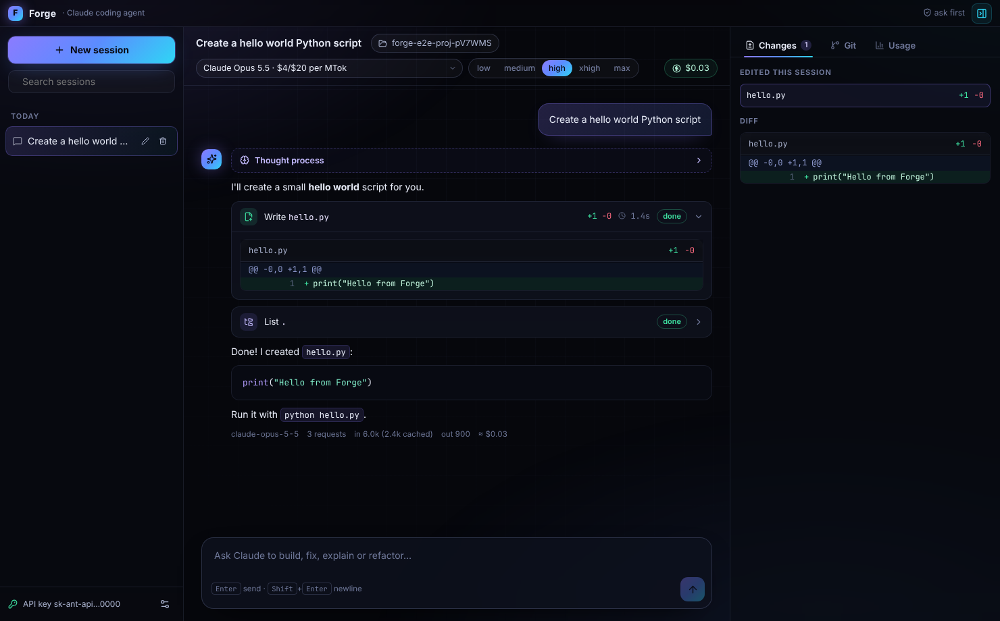
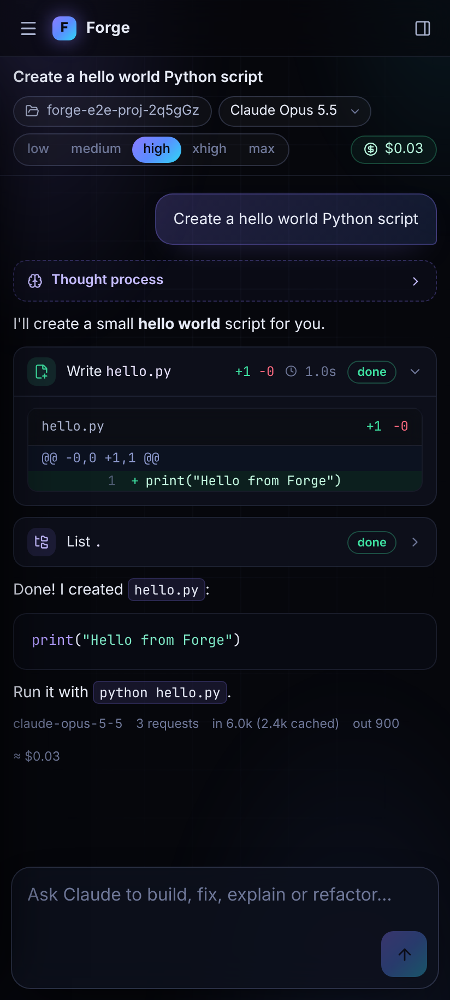
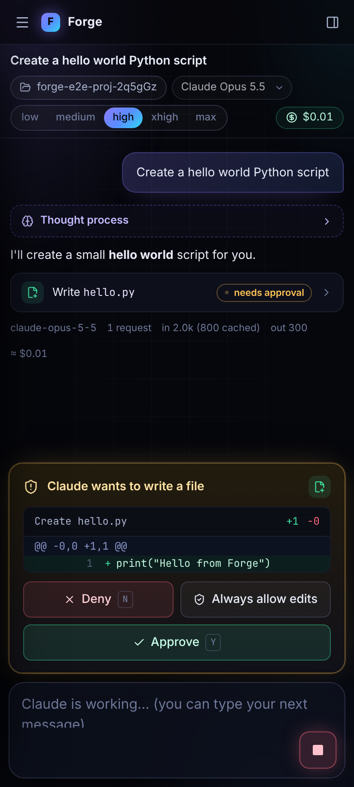
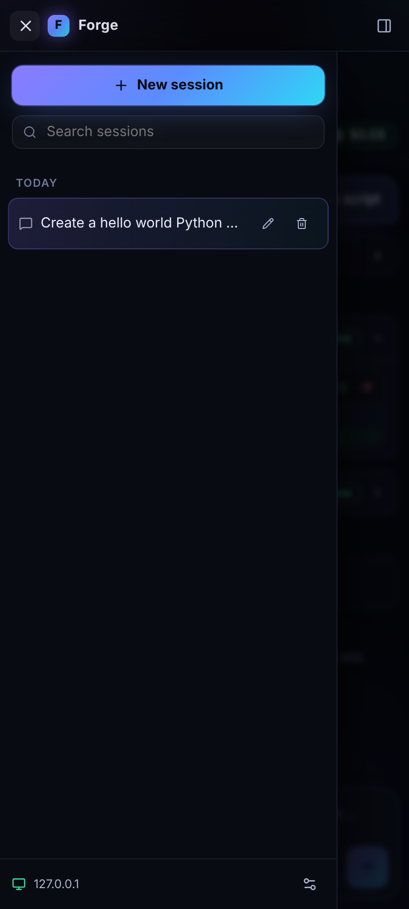
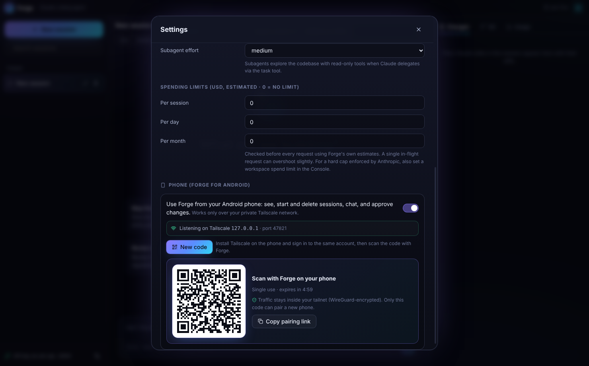
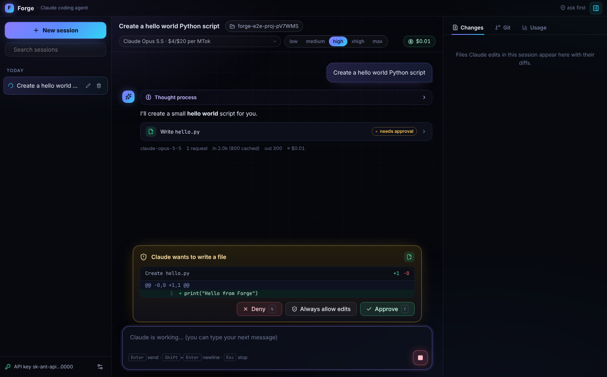
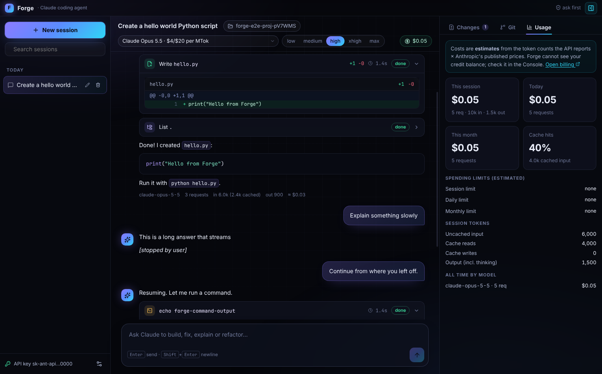

# Forge

A Windows 11 desktop coding agent, with an Android companion app, that runs Claude through the **official Anthropic Messages API** with your own API key. It does not use the Claude Code executable or a Claude subscription login.



## Why it bills your API credits

Anthropic's monthly API credits for Max and Team plans cover "The Claude API (Messages API and Message Batches API)", the Console Playground, Managed Agents and the Agent SDK. They exclude "Interactive Claude Code in the terminal, IDE, desktop, or web" ([support article](https://support.claude.com/en/articles/17154008-monthly-api-credits-for-max-and-team-plans)). Forge calls `POST /v1/messages` on `api.anthropic.com` directly with the key you enter, so its usage is ordinary Claude API usage on that key's Console organization. It doesn't use any workaround.

## Install

1. Download `Forge-Setup-<version>.exe` (installer) or `Forge-Portable-<version>.exe` (no install) from [Releases](../../releases/latest).
2. The build is not code-signed, so SmartScreen may warn you. Click **More info → Run anyway**.
3. On first launch, paste your API key (`sk-ant-…`) and press **Save & test**. The test sends one tiny Claude Haiku 5.5 request to confirm the key can actually bill.
4. Choose a project folder and start asking.

## Forge for Android

Use Forge from your phone: see, start, rename and delete sessions, chat with live streaming, approve or deny edits and commands, stop and continue runs, switch model and effort, and browse the Changes, Git and Usage panels. The agent still runs on your PC with your PC's API key; the phone is a remote control over your private [Tailscale](https://tailscale.com) network. It is the same UI as the desktop app, laid out for a phone.

| Chat | Approve from the phone | Sessions |
|---|---|---|
|  |  |  |

**Set up**

1. Install Tailscale on the PC and on the phone, and sign in to the **same** tailnet on both.
2. Download `Forge-Android-<version>.apk` from [Releases](../../releases/latest) on the phone and open it (allow installs from your browser or Files app when Android asks).
3. On the PC: Forge → **Settings → Phone**, turn it on, press **Pair a phone**. If Windows Firewall asks whether Forge may accept connections, allow it (Forge listens only on the Tailscale address).
4. In Forge on the phone, tap **Scan QR code** and scan the code on the PC screen.



Settings → Phone on the PC lists paired phones (online or last seen); **Remove** disconnects a phone immediately. A phone can also unpair itself from its own Settings.

**Security model**

- The PC only listens on its **Tailscale address** (100.64.0.0/10 or fd7a:115c:a1e0::/48), never on your LAN or the internet, and drops any connection from outside those ranges. Tailscale (WireGuard) encrypts and authenticates all traffic between the two devices.
- Pairing needs a **single-use code that expires in 5 minutes** and exists only in the QR code. Pairing gives the phone its own random 256-bit token. The PC stores only a SHA-256 hash of it, compares it in constant time, and rate-limits pairing attempts.
- The phone can only call an **allowlist** of actions, with validated arguments. It can never read or change the API key or the settings, open URLs or dialogs on the PC, or manage phone access.
- The phone can only point sessions and the Git panel at **project folders already used on the PC**.
- Phone access is **off by default**.

**Release signing (one time, optional but recommended).** Android only installs an update over an existing app when both are signed with the same key. Create a key once and store it as repository secrets; CI then signs every APK with it:

```bash
keytool -genkeypair -v -keystore forge-release.jks -alias forge -keyalg RSA -keysize 4096 -validity 10000
base64 -w0 forge-release.jks   # on macOS: base64 -i forge-release.jks
```

Add these repository secrets (Settings → Secrets and variables → Actions): `ANDROID_KEYSTORE_BASE64` (the base64 output), `ANDROID_KEYSTORE_PASSWORD`, `ANDROID_KEY_ALIAS` (`forge`) and `ANDROID_KEY_PASSWORD` (the same as the keystore password unless you chose another). Without them CI signs with a throwaway debug key, so each APK must be installed fresh (uninstall the old one first). After switching to your own key, uninstall the debug-signed app once.

## Features

- **Coding agent loop.** Streams `messages.stream` responses and runs tools until the task is done: `read_file`, `write_file`, `edit_file`, `list_dir`, `glob`, `grep`, `run_command` (PowerShell 7 if installed, otherwise Windows PowerShell), `git_status`, `git_diff` and `git_log`. Tool inputs are validated with zod and confined to the project folder; symlink and junction escapes are refused.
- **Subagents.** The `task` tool lets Claude hand broad exploration to a read-only subagent. The subagent's model and effort are configurable; the default is Sonnet 5.5 at medium effort.
- **Models.** Claude Opus 5.5 is the default. Fable 5.1, Sonnet 5.5, Haiku 5.5, Opus 5, Fable 5, Sonnet 5, Opus 4.8 and Opus 4.7 are also available. Effort can be low, medium, high, xhigh or max, with adaptive thinking and summarized thinking shown live.
- **Approvals.** Four modes: ask before edits and commands, auto-approve edits, auto-approve everything, or read-only. Approval cards show the exact diff or command. Keys: `Y` approve, `N` deny, plus "always allow" for the rest of the session.
- **Controls.** Stop (Esc) kills running commands and keeps the partial answer. Continue resumes after a stop, the output limit, the step limit or an error.
- **Sessions.** Create, rename (double-click), delete, search and resume sessions. The full API history is saved to disk, including thinking signatures, so resumed conversations remain valid for the API.
- **Spending.**
  - Every request's token usage (input, output, cache reads and writes) is recorded, and its cost is estimated from Anthropic's published prices.
  - You can set per-session, daily and monthly limits; they are checked before each request.
  - Forge never shows a credit balance, because it cannot read one. Check yours at the Console's Billing page.
- **Git and diffs.** The Changes panel shows the diffs Claude made this session. The Git panel shows status, a per-file `git diff` and recent commits.
- **Security.**
  - The API key is encrypted with Windows DPAPI through Electron `safeStorage`. It is never written in plaintext or sent to the renderer.
  - The renderer runs sandboxed with context isolation, no Node access and a strict Content Security Policy.
  - Requests always go to `https://api.anthropic.com`. `ANTHROPIC_BASE_URL` and `ANTHROPIC_AUTH_TOKEN` from the environment are ignored.
- **Cost-aware requests.** Prompts are cached, which makes repeated context much cheaper. Tool input is streamed eagerly, so long file writes appear as they're generated. Refusal fallback (`fallbacks: "default"`) is optional and on by default.

| Approvals | Usage |
|---|---|
|  |  |

## Develop

```bash
npm install
npm run dev          # Electron + Vite with hot reload
npm run typecheck
npm test             # unit tests (agent loop, tools, stores, pricing)
npm run test:e2e     # drives the real app against a local mock of the Messages API (use xvfb-run on Linux)
npm run dist:win     # build the NSIS installer and portable EXE (on Windows)
npm run test:e2e:mobile  # pairs the phone web app (in Chromium at a phone size) with the real desktop app
npm run android:apk  # build the Android APK (needs JDK 21 and the Android SDK; ANDROID_HOME set)
```

Stack: Electron 44, React 19, TypeScript, Vite (electron-vite), and the official `@anthropic-ai/sdk`.

- `src/main/agent/agent.ts`: the agent loop.
- `src/main/agent/tools.ts`: the tools.
- `src/renderer/src`: the UI (shared by the desktop and Android apps).
- `src/main/remote`: phone access (Tailscale detection, pairing, device tokens, the HTTP/WebSocket server).
- `src/renderer/src/remote` + `src/renderer/src/mobile-main.tsx`: the Android app's connection to the PC. The Android shell is a Capacitor project in `mobile/android`.

CI (`.github/workflows/release.yml`) does the following on every push:

- Runs the tests on Linux and on Windows, including the phone-to-PC end-to-end test.
- Builds both Windows executables, smoke-tests the packaged `Forge.exe` and uploads the executables as artifacts.
- Builds the Android APK (`Forge-Android-<version>.apk`) and uploads it as an artifact.
- On `main`, also publishes a GitHub Release `v1.0.<run>` with the installer, the portable EXE and the APK.
